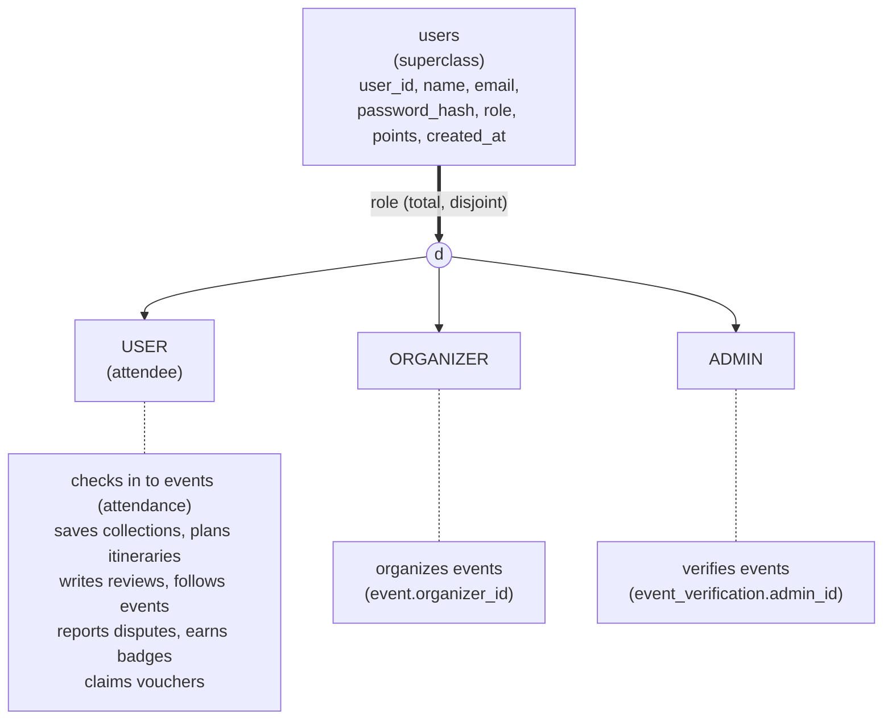

# Ayojon EER Diagram

This diagram describes the database in `src/main/resources/normalized_schema.sql`
(24 tables, PostgreSQL). It matches that file table for table and column for column.
A full image of the diagram is in [Ayojon_EER_Diagram.png](Ayojon_EER_Diagram.png).

**How to read it**

- Each box is an entity (a table) with its attributes (columns).
  `PK` = primary key, `FK` = foreign key, `UK` = unique.
- Lines show relationships, with how many rows can be on each side:
  `||` exactly one, `|o` zero or one, `o{` zero or many.
- The label on a line says what the relationship means, read from the first entity to the second.

## 1. Specialization of users (the "E" in EER)

All accounts live in one `users` table. The `role` column splits them into three
**disjoint** subtypes: every user is exactly one of USER, ORGANIZER or ADMIN.
The split is **total**, because `role` is `NOT NULL` and limited to those three values.
Each subtype takes part in different relationships:

## 2. Entities and relationships

```mermaid
erDiagram
    users ||--o{ event : "organizes"
    event_category ||--o{ event : "classifies"
    area ||--o{ venue : "contains"
    venue ||--o{ event : "hosts"

    event ||--o{ event_media : "has"
    event ||--o{ ticket_tier : "is priced by"

    users ||--o{ attendance : "checks in"
    event ||--o{ attendance : "is attended in"

    users ||--o{ collection : "owns"
    collection ||--o{ collection_event : "contains"
    event ||--o{ collection_event : "is saved in"

    users ||--o{ itinerary : "plans"
    itinerary ||--o{ itinerary_item : "contains"
    event ||--o{ itinerary_item : "is scheduled in"

    users ||--o{ review : "writes"
    event ||--o{ review : "receives"

    users ||--o{ dispute_report : "reports"
    event ||--o{ dispute_report : "is reported in"
    dispute_reason ||--o{ dispute_report : "categorizes"

    users ||--o{ event_verification : "verifies (admin)"
    event ||--o{ event_verification : "is verified in"

    users ||--o{ event_change_log : "changes"
    event ||--o{ event_change_log : "is logged in"

    users ||--o{ event_follow : "follows"
    event ||--o{ event_follow : "is followed in"

    users ||--o{ notification : "receives"
    event |o--o{ notification : "is about"

    users ||--o{ user_badge : "earns"
    badge ||--o{ user_badge : "is awarded as"
    attendance |o--o{ user_badge : "unlocks"

    sponsor ||--o{ voucher : "offers"
    users ||--o{ voucher_claim : "claims"
    voucher ||--o{ voucher_claim : "is claimed in"

    users {
        int user_id PK
        varchar name
        varchar email UK
        varchar password_hash
        varchar role "USER, ORGANIZER or ADMIN"
        int points "total score, never negative"
        timestamptz created_at
    }
    event_category {
        int category_id PK
        varchar category_name UK
    }
    area {
        int area_id PK
        varchar area_name UK
    }
    venue {
        int venue_id PK
        int area_id FK
        varchar venue_name
        text venue_address
        decimal latitude
        decimal longitude
    }
    event {
        int event_id PK
        int organizer_id FK
        int category_id FK
        int venue_id FK
        varchar title
        text description
        timestamptz start_time
        timestamptz end_time "after start_time"
        text ticket_url
        varchar status "DRAFT, PUBLISHED, CANCELLED, COMPLETED"
        timestamptz created_at
    }
    event_media {
        int media_id PK
        int event_id FK
        text media_url
        varchar media_type "IMAGE, VIDEO or POSTER"
    }
    ticket_tier {
        int tier_id PK
        int event_id FK
        varchar tier_name
        decimal price "0 or more"
    }
    attendance {
        int attendance_id PK
        int user_id FK
        int event_id FK
        timestamptz checked_in_at
    }
    collection {
        int collection_id PK
        int user_id FK
        varchar collection_name
        boolean is_private
    }
    collection_event {
        int collection_id PK, FK
        int event_id PK, FK
        timestamptz saved_at
    }
    itinerary {
        int itinerary_id PK
        int user_id FK
        varchar plan_name
        date plan_date
    }
    itinerary_item {
        int itinerary_id PK, FK
        int event_id PK, FK
        timestamptz scheduled_start
        timestamptz scheduled_end
    }
    review {
        int review_id PK
        int user_id FK
        int event_id FK
        int rating "1 to 5"
        text review_text
        timestamptz created_at
    }
    dispute_reason {
        int reason_id PK
        varchar reason_name UK
    }
    dispute_report {
        int report_id PK
        int reporter_id FK
        int event_id FK
        int reason_id FK
        text details
        varchar status "PENDING, UNDER_REVIEW, RESOLVED, DISMISSED"
        timestamptz created_at
    }
    event_verification {
        int verification_id PK
        int event_id FK
        int admin_id FK
        text source_url
        varchar decision "APPROVED or REJECTED"
        timestamptz verified_at
    }
    event_change_log {
        int change_id PK
        int event_id FK
        int changed_by FK
        text change_description
        timestamptz changed_at
    }
    event_follow {
        int user_id PK, FK
        int event_id PK, FK
        timestamptz followed_at
    }
    notification {
        int notification_id PK
        int user_id FK
        int event_id FK "optional"
        text message
        boolean is_read
        timestamptz created_at
    }
    badge {
        int badge_id PK
        varchar badge_name UK
        int milestone_points
        text description
    }
    user_badge {
        int user_id PK, FK
        int badge_id PK, FK
        int attendance_id FK "optional"
        timestamptz earned_at
    }
    sponsor {
        int sponsor_id PK
        varchar sponsor_name
    }
    voucher {
        int voucher_id PK
        int sponsor_id FK
        varchar promo_code UK
        decimal discount_percent "above 0, up to 100"
        timestamptz valid_until
    }
    voucher_claim {
        int user_id PK, FK
        int voucher_id PK, FK
        timestamptz claimed_at
    }
```

## 3. Notes

- **Associative entities.** `collection_event`, `itinerary_item`, `event_follow`, `user_badge`
  and `voucher_claim` turn many-to-many relationships into tables. Their primary key is made
  of the two foreign keys, so the same pair can't be stored twice.
- **One per user and event.** `attendance` and `review` each allow only one row per
  user and event (`UNIQUE (user_id, event_id)`). A user checks in once and reviews once.
- **Derived attribute.** Whether an event is verified is not stored on `event`. The view
  `event_verified` works it out from the latest `event_verification` decision.
- **Optional relationships.** `notification.event_id` and `user_badge.attendance_id` can be
  empty: a notification doesn't have to be about an event, and a badge doesn't have to come
  from one check-in.
- **Deleting.** Removing a user or an event also removes the rows that depend on it
  (`ON DELETE CASCADE`). Categories, areas, venues and dispute reasons can't be deleted while
  something still uses them (`ON DELETE RESTRICT`).

## 4. Which features use which entities

| Feature | Entities |
|---|---|
| Nearby events (F1), heat map (F2) | venue, area, event, attendance |
| Points, badges, leaderboard (F3) | users.points, attendance, badge, user_badge |
| Sponsor vouchers (F4) | sponsor, voucher, voucher_claim |
| Search & filter (F5), event profile (F6) | event, event_category, venue, area, ticket_tier, event_media |
| Verified badge (F7) | event_verification, event_verified view |
| Trending (F8), collections (F9) | collection, collection_event |
| Weekend planner (F10), overlap check (F11), calendar export (F13) | itinerary, itinerary_item, event |
| Follow + notifications (F12) | event_follow, notification |
| Dispute reports (F14) | dispute_reason, dispute_report |
| Ratings & reviews (F15) | review |
| Submit / edit / cancel events (F16, F17) | event, event_media, ticket_tier, event_change_log |
| Admin approval & status (F18) | event.status, event_verification |
| Recommendations (F19) | collection_event, event, event_category |
| Attendance dashboard (F20) | attendance, event, event_category, venue, area |

## 5. Normalized design vs. the running database

This diagram is the normalized design (`normalized_schema.sql`). The app's live
database still uses the earlier flat layout in `src/main/resources/schema.sql`,
and the code on `main` (event search and details, organizer submission, admin
review, disputes) reads that flat layout. No schema change has been made.
The two differ only in these places:

| Normalized design (this diagram) | Running database (`schema.sql`) |
|---|---|
| `venue` entity (name, address, latitude, longitude) and `event.venue_id` | `event.venue_name`, `venue_address`, `latitude`, `longitude` stored on each event |
| `area` entity and `venue.area_id` | `event.area` as text |
| `dispute_reason` lookup and `dispute_report.reason_id` | `dispute_report.reason_category` as text |
| Price derived from `ticket_tier` (a free event has a tier priced 0) | `event.base_price` |
| "Verified" derived from `event_verification` (`event_verified` view) | `event.is_verified` |
| `event_media` for images | `event.poster_url` (event_media also exists) |
| (no sequence number) | `itinerary_item.sequence_no` |

Every other table and column is the same in both. If the team moves the live
database to the normalized schema, the queries in the `model/*Repository.java`
files that use the flat columns above must change with it.
