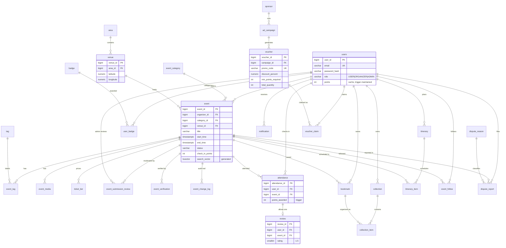

# Ayojon Database

PostgreSQL (Supabase), managed by **Flyway** and accessed through **Spring Data JPA**.
The schema covers all 20 features in the sprint guide.

| What | Where |
|---|---|
| Schema migrations | `src/main/resources/db/migration/V1…V5__*.sql` |
| Demo data (runs once per database) | `src/main/resources/db/seed/R__demo_data.sql` |
| JPA entities / enums | `src/main/java/com/ayojon/entity` |
| Repositories + typed read models | `src/main/java/com/ayojon/repository` |
| SQL self-test (49 checks, rolls back) | `src/test/resources/db/verify_business_rules.sql` |
| Java integration test | `src/test/java/com/ayojon/repository/DatabaseIntegrationTest.java` |
| One-time cleanup of old draft tables | `docs/database/drop_legacy_draft_tables.sql` |

---

## 1. Setup

1. Copy `src/main/resources/application.properties.example` to `application.properties`
   (gitignored) and put in the Supabase password. Keep these lines from the example:
   ```properties
   spring.jpa.hibernate.ddl-auto=validate
   spring.flyway.locations=classpath:db/migration,classpath:db/seed
   ```
2. Start the app (`./mvnw spring-boot:run`). On the first start, Flyway creates every table,
   view, function and trigger, then loads the demo data. Later starts only apply new migrations.
3. If startup fails with *"Found non-empty schema(s) "public" but no schema history table"*,
   someone ran the old draft SQL in Supabase. Run `docs/database/drop_legacy_draft_tables.sql`
   in the Supabase SQL editor once, then start again.

**Demo logins** (password `password123` for all):
`admin@ayojon.dev` (ADMIN) · `beats@`, `techhub@`, `foodies@ayojon.dev` (ORGANIZER) ·
`rafi@`, `nabila@`, `tanvir@`, `sadia@`, `arif@ayojon.dev` (USER).
The hash is BCrypt, so use Spring Security's `BCryptPasswordEncoder` to check passwords.

## 2. Rules for changing the schema

- **Never edit a migration that has already been applied.** Flyway checks file checksums and
  will refuse to start. Add a new file instead, e.g. `V6__add_event_capacity.sql`.
- Then update the matching entity. `ddl-auto=validate` makes the app fail fast if the entity and
  the table don't match. Hibernate never changes tables itself.
- Pick version numbers in the team chat before you merge, so two branches don't both add `V6`.

## 3. What the database does for you

These run inside PostgreSQL triggers, so they hold no matter which code path writes the data.
Don't re-implement them in Java.

| Feature | When you… | the database automatically… |
|---|---|---|
| F18 | save an `EventSubmissionReview` | moves the event to PUBLISHED / REJECTED / REVISION_REQUESTED and notifies the organizer. Only PENDING_REVIEW events can be reviewed, and rejecting or requesting revisions needs a comment. |
| F7 | save an `EventVerification` | requires `sourceUrl` for VERIFIED and notifies the organizer. `Event.isVerified()` reflects the latest decision. |
| F17, F12 | update an `Event` | writes one `event_change_log` row per changed field and notifies followers when the time or venue changes or the event is cancelled. **Set `event.setUpdatedBy(currentUser)`** so the log records who made the change. |
| F3 | save an `Attendance` | rejects the check-in unless the event is PUBLISHED, awards `checkInPoints` (verified events only, otherwise 0), updates `users.points` and grants and announces badges. |
| F15 | save a `Review` | rejects it unless the user has an `Attendance` row for that event (composite foreign key). |
| F9 | save a `CollectionItem` | fills in the owner and bookmarks the event if it wasn't already. |
| F10 | save an `ItineraryItem` | rejects events that aren't PUBLISHED or fall outside the plan's dates. |
| F4 | save a `VoucherClaim` | checks the voucher is active, inside its validity window, in stock (row-locked) and that the user has `minPointsRequired` points. |
| F14 | set a `DisputeReport` to RESOLVED or DISMISSED | stamps `resolvedAt` and notifies the reporter. Only admins can resolve. |
| all | — | enforces roles: only ORGANIZER or ADMIN can own events, only ADMIN can moderate. Maintains `updated_at`. |

A rule violation comes back as a Spring `DataAccessException`. Constraint and trigger checks
usually surface as `DataIntegrityViolationException`, and role checks as a permission-denied
subclass. The message is readable, so catch it in your service and return a 400 or 403.

After saving something a trigger changes (for example a submission review changes the event's
status), call `entityManager.refresh(event)` or load the event again to see the new values.

## 4. Feature → where to read the data

| # | Feature | Owner | Repository method (SQL object) |
|---|---|---|---|
| F1 | Nearby GPS discovery | Nora | `EventRepository.findNearby(lat, lng, km)` (`events_nearby`) |
| F2 | Attendance heat map | Sabbir | `AttendanceRepository.heatmap(userId)` (`v_user_heatmap`) |
| F3 | Points, badges, leaderboard | Sabbir | `UserRepository.leaderboard(n)` (`v_leaderboard`), `UserBadgeRepository` |
| F4 | Sponsor vouchers | Sabbir | `VoucherRepository.findClaimable()` (`v_voucher_availability`), `VoucherClaimRepository` |
| F5 | Multi-filter search | Tasnia | `EventRepository.search(keyword, from, to, areaId, categoryId, minPrice, maxPrice)` (`search_events`) — every argument may be null |
| F6 | Event profile | Tasnia | `EventRepository.findCard(id)`, `TicketTierRepository`, `EventMediaRepository` |
| F7 | Verified badge | Nawshin | `EventVerificationRepository`, `Event.isVerified()` |
| F8 | Trending by weekly saves | Tasnia | `EventRepository.findTrending(n)` (`v_trending_events`) |
| F9 | Collections & wishlists | Tasnia | `CollectionRepository`, `CollectionItemRepository`, `BookmarkRepository` |
| F10 | Weekend itinerary | Tasnia | `ItineraryRepository`, `ItineraryItemRepository.schedule(id)` (`v_itinerary_schedule`) |
| F11 | Overlap detection | Nawshin | `EventRepository.findOverlapping(...)`, `v_venue_event_overlap`, `has_conflict` in the schedule |
| F12 | Follow + notifications | Nawshin | `EventFollowRepository`, `NotificationRepository` |
| F13 | Calendar export | Nora | `ItineraryItemRepository.calendarExport(id)` (`v_calendar_export`) |
| F14 | Dispute reports | Nora | `DisputeReportRepository.openQueue()` (`v_dispute_queue`) |
| F15 | Ratings & reviews | Nawshin | `ReviewRepository`. Averages come from `EventCard.getAvgRating()`. |
| F16 | Submit event | Nora | `EventRepository.save` with `EventMedia`, `TicketTier`, `Event.tags` |
| F17 | Edit/cancel + public log | Nora | `EventChangeLogRepository.publicLog(id)` (`v_public_event_change_log`) |
| F18 | Approval queue & status | Nawshin | `EventSubmissionReviewRepository.pendingQueue()`, `.statusForOrganizer(id)` |
| F19 | Recommendations | Sabbir | `EventRepository.recommendFor(userId, n)` (`recommend_events`) |
| F20 | Attendance dashboard | Sabbir | `AttendanceRepository.summary / monthlyTrend / categoryBreakdown / areaBreakdown` |

## 5. Design notes

- **Normalized (3NF).** Venue and area are separate tables, and price, poster and verification are
  not stored on `event`. Derived facts (`is_verified`, min price, rating, trending score) are
  computed in views. The one deliberate cache is `users.points`, kept correct by trigger.
- **Event lifecycle:** `DRAFT → PENDING_REVIEW → PUBLISHED | REJECTED | REVISION_REQUESTED`,
  `REVISION_REQUESTED → PENDING_REVIEW`, `PUBLISHED → CANCELLED` (needs `cancellationReason`).
  An event is "completed" when `end_time < now()`. That is not a status.
- **Bookmarks vs. collections:** a bookmark is the single "saved" fact used by trending and
  recommendations. Collections only organise bookmarks, so the same event in two collections
  isn't counted twice.
- **Times:** every column is `timestamptz` (stored as UTC). Show times in `Asia/Dhaka`.
- **IDs** are `BIGINT` identity columns, so `Long` in Java.
- **Supabase security (V5):** Supabase exposes `public` tables through its REST API using the
  public anon key. We enable Row Level Security and revoke API access, so only our backend can
  read data such as `password_hash`.

## 6. Verifying the database

- **SQL:** paste `src/test/resources/db/verify_business_rules.sql` into the Supabase SQL editor.
  The last notice should be `ALL DATABASE CHECKS PASSED`. It rolls back, so nothing changes.
- **Java:** `./mvnw test` runs `DatabaseIntegrationTest` against the configured database,
  inside rolled-back transactions.

## 7. ER diagram


