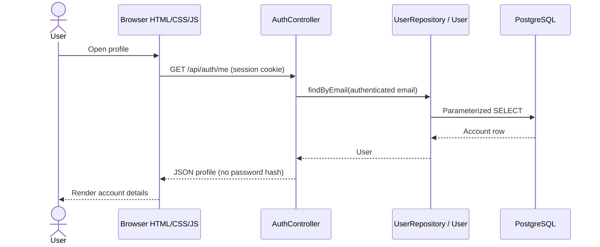

# Ayojon MVC architecture

The CSE470 Week 4 MVC slides separate user interaction (Controller), data
handling (Model), and presentation (View). Ayojon uses these responsibilities
with Spring MVC JSON controllers and browser-rendered HTML views.

| Part | Project files | Responsibility |
| --- | --- | --- |
| Model | `model/User.java`, `model/UserRepository.java` | Represent account data and execute parameterized database queries. Password hashes stay out of JSON responses. |
| Controller | `controller/AuthController.java` | Handle authentication URLs, validate signup input, call the model, and return response data or HTTP errors. |
| View | `resources/static/index.html`, `styles.css`, `assets/js/auth.js`, `assets/js/profile.js` | Display the interface, submit user actions, and render controller responses. |
| Routing and security | Spring MVC annotations, `config/SecurityConfig.java` | Route requests, enforce CSRF, authenticate sessions, and handle login/logout. Authentication reads accounts through the same model repository. |

Signup follows the same direction: the view submits JSON and a CSRF token,
the controller validates and normalizes input and hashes the password, and
the model inserts the account. Spring Security handles login and logout;
its login lookup uses `UserRepository` rather than its own SQL.

The slides' student example (4.2, pages 10-22) renders an HTML template on
the server. This project deliberately retains browser rendering and its
existing dependencies: the controller returns JSON, and JavaScript updates
the HTML view. It does not use server-side templates. Confirm this rendering
choice with the instructor if the assignment requires that exact example.

The backend currently implements accounts only. Event discovery, saved items,
planner, organizer, and admin screens remain UI previews; database tables
alone do not make those features implemented MVC flows. Add their model and
controller code when implementing those features.

No schema migration or new dependency is needed. Existing `/api/auth/*`
URLs, static asset URLs, hash navigation, signup rules, and session security
remain compatible.

Run `./mvnw test` (Windows: `.\mvnw.cmd test`). `AuthControllerTests` runs
against a mocked model with real Spring MVC and security filters, so it needs
no database and creates no accounts. The existing application context test
uses the locally configured datasource.
