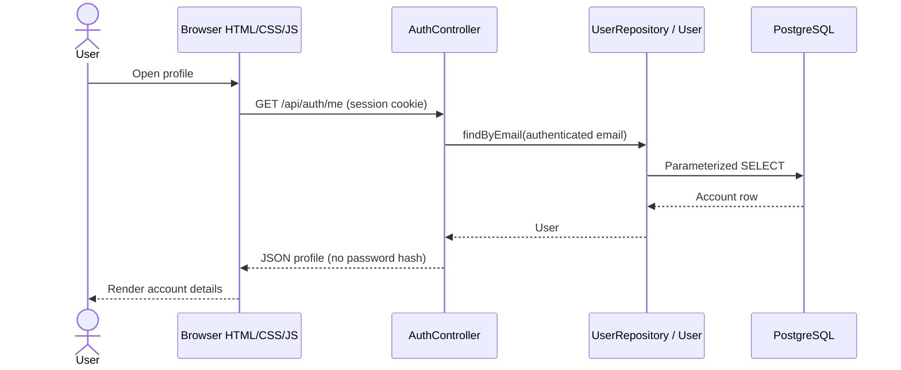

# Ayojon MVC architecture

The CSE470 Week 4 MVC slides separate user interaction (Controller), data
handling (Model), and presentation (View). Ayojon uses these responsibilities
with Spring MVC JSON controllers and browser-rendered HTML views.

| Part | Project files | Responsibility |
| --- | --- | --- |
| Model | `model/User.java`, `model/UserRepository.java` | Represent account data and execute parameterized database queries. Password hashes stay out of JSON responses. |
| Model | `model/Event.java`, `model/EventDetails.java`, `model/EventCategory.java`, `model/EventFilter.java`, `model/EventRepository.java` | Represent events and run the parameterized event search (F5) and single-event lookup (F6). |
| Controller | `controller/AuthController.java` | Handle authentication URLs, validate signup input, call the model, and return response data or HTTP errors. |
| Controller | `controller/EventController.java` | Handle `/api/events` URLs: validate search filters, call `EventRepository`, and return events or HTTP errors. |
| View | `resources/static/index.html`, `styles.css`, `assets/js/auth.js`, `assets/js/profile.js` | Display the interface, submit user actions, and render controller responses. |
| View | `assets/js/discover.js`, `assets/js/event-detail.js`, `assets/js/event-format.js` | Discover search and filters (F5) and the event detail page (F6). |
| Routing and security | Spring MVC annotations, `config/SecurityConfig.java` | Route requests, enforce CSRF, authenticate sessions, and handle login/logout. Authentication reads accounts through the same model repository. |



Signup follows the same direction: the view submits JSON and a CSRF token,
the controller validates and normalizes input and hashes the password, and
the model inserts the account. Spring Security handles login and logout;
its login lookup uses `UserRepository` rather than its own SQL.

The slides' student example (4.2, pages 10-22) renders an HTML template on
the server. This project deliberately retains browser rendering and its
existing dependencies: the controller returns JSON, and JavaScript updates
the HTML view. It does not use server-side templates. Confirm this rendering
choice with the instructor if the assignment requires that exact example.

The backend implements accounts, event search (F5) and event details (F6).
Saved items, planner, organizer, and admin screens remain UI previews;
database tables alone do not make those features implemented MVC flows. Add
their model and controller code when implementing those features.

## Event search and details (F5, F6)

| URL (login required) | Returns |
| --- | --- |
| `GET /api/events?q=&categoryId=&city=&from=&until=&price=` | Upcoming published events matching every given filter, soonest first (at most 100). `price` is `free` or `paid`; dates are `YYYY-MM-DD`. |
| `GET /api/events/categories` | All categories, used for the Discover category buttons. |
| `GET /api/events/{id}` | One event with its organizer, or 404 if it doesn't exist or is a draft. |

```mermaid
sequenceDiagram
    actor User
    participant View as discover.js / event-detail.js
    participant Controller as EventController
    participant Model as EventRepository
    participant DB as PostgreSQL
    User->>View: Type a keyword or change a filter
    View->>Controller: GET /api/events?q=jazz&city=Dhaka&price=free
    Controller->>Controller: Check the filters (400 with a message if invalid)
    Controller->>Model: search(EventFilter)
    Model->>DB: SELECT with one ? condition per filter
    DB-->>Model: Event rows
    Model-->>Controller: List of Event
    Controller-->>View: JSON events
    View-->>User: Event cards; a click opens #event-detail?id=...
```

The queries read the `event` table as it exists in the database
(`schema.sql`): area, venue, `base_price`, `poster_url` and `is_verified`
are columns of `event`. Event times are stored as Dhaka local time. The city
filter matches the event's area or its venue address, because Dhaka events
often store the neighbourhood (e.g. Gulshan) as the area.

No schema migration or new dependency is needed. Existing `/api/auth/*`
URLs, static asset URLs, hash navigation, signup rules, and session security
remain compatible.

Run `./mvnw test` (Windows: `.\mvnw.cmd test`). `AuthControllerTests` and
`EventControllerTests` run against a mocked model with real Spring MVC and
security filters, so they need no database and create no accounts.
`EventRepositoryTests` checks the search SQL and its bound values. The existing application context test
uses the locally configured datasource.
