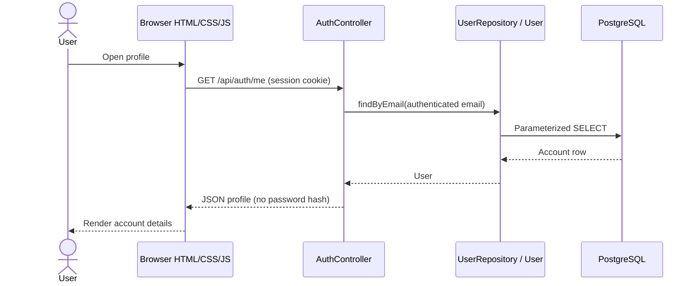

# Ayojon MVC architecture

The CSE470 Week 4 MVC slides separate user interaction (Controller), data
handling (Model), and presentation (View). Ayojon uses these responsibilities
with Spring MVC JSON controllers and browser-rendered HTML views.

| Part | Project files | Responsibility |
| --- | --- | --- |
| Model | `model/User.java`, `model/UserRepository.java`, `model/Attendance.java`, `model/AttendanceRepository.java` | Represent account and attendance data and execute parameterized database queries. Password hashes stay out of JSON responses. |
| Model | `model/Event.java`, `model/EventNotEditableException.java`, `model/EventRepository.java` | Organizer and admin view of an event (any status): submission, editing drafts, and review. |
| Model | `model/EventSummary.java`, `model/EventDetails.java`, `model/EventCategory.java`, `model/EventFilter.java`, `model/EventRepository.java` | Public discovery: the parameterized event search (F5) and the published-only event lookup (F6). |
| Controller | `controller/AuthController.java`, `controller/AttendanceController.java` | Handle authentication and attendance URLs, validate input, call the model, and return response data or HTTP errors. |
| Controller | `controller/EventController.java` | Handle `/api/events` URLs: validate search filters and organizer submissions, call `EventRepository`, and return events or HTTP errors. |
| Controller | `controller/AdminController.java` | Handle `/api/admin` URLs for admin review of events, users and disputes. |
| View | `resources/static/index.html`, `styles.css`, `assets/js/auth.js`, `assets/js/profile.js` | Display the interface, submit user actions, and render controller responses. |
| View | `assets/js/discover.js`, `assets/js/event-detail.js`, `assets/js/event-format.js` | Discover search and filters (F5) and the event detail page (F6). |
| Routing and security | Spring MVC annotations, `config/SecurityConfig.java` | Route requests, enforce CSRF, authenticate sessions, and handle login/logout. Authentication reads accounts through the same model repository. |



Signup follows the same direction: the view submits JSON and a CSRF token,
the controller validates and normalizes input and hashes the password, and
the model inserts the account. Spring Security handles login and logout;
its login lookup uses `UserRepository` rather than its own SQL.

The slides' student example (4.2, pages 10-22) renders an HTML template on
the server. This project deliberately retains browser rendering and its
existing dependencies: the controller returns JSON, and JavaScript updates
the HTML view. It does not use server-side templates. Confirm this rendering
choice with the instructor if the assignment requires that exact example.

The backend implements accounts, the attendance foundation, event search (F5),
event details (F6), organizer event submission, and admin review. Saved items
and planner screens remain UI previews; database tables alone do not make
those features implemented MVC flows. Add their model and controller code when
implementing those features.

## Event search and details (F5, F6)

| URL (login required) | Returns |
| --- | --- |
| `GET /api/events?q=&categoryId=&city=&from=&until=&price=` | Upcoming published events matching every given filter, soonest first (at most 100). `price` is `free` or `paid`; dates are `YYYY-MM-DD`. |
| `GET /api/events/categories` | All categories, used for the Discover category buttons. |
| `GET /api/events/{id}` | One published event with its organizer, or 404 if it doesn't exist or isn't published. |

**Visibility policy.** Search and the public detail page show only events whose
status is `PUBLISHED` (`EventRepository.PUBLIC_STATUS`). This is an allow-list:
drafts (`DRAFT`) and rejected submissions (the admin's reject sets `CANCELLED`)
can't be found through them, and they answer 404 exactly like a missing event.
Organizers still see all of their own submissions through `GET /api/events/mine`
and edit drafts through `PUT /api/events/{id}`; admins see every event through
`/api/admin/events/...`. Those privileged lookups use `EventRepository.findById`,
which the public pages never call.

```mermaid
sequenceDiagram
    actor User
    participant View as discover.js / event-detail.js
    participant Controller as EventController
    participant Model as EventRepository
    participant DB as PostgreSQL
    User->>View: Type a keyword or change a filter
    View->>Controller: GET /api/events?q=jazz&city=Dhaka&price=free
    Controller->>Controller: Check the filters (400 with a message if invalid)
    Controller->>Model: search(EventFilter)
    Model->>DB: SELECT ... WHERE status = 'PUBLISHED' plus one ? condition per filter
    DB-->>Model: Event rows
    Model-->>Controller: List of EventSummary
    Controller-->>View: JSON events
    View-->>User: Event cards; a click opens #event-detail?id=...
```

The queries read the `event` table as it exists in the database
(`schema.sql`): area, venue, `base_price`, `poster_url` and `is_verified`
are columns of `event`. Posters come from `event.poster_url`, the same column
organizers fill when they submit an event. Event times are stored as Dhaka
local time. The city filter matches the event's area or its venue address,
because Dhaka events often store the neighbourhood (e.g. Gulshan) as the area.

The detail page only lets its newest request change the screen. Navigating
away, or opening a missing or invalid id, cancels the pending request, so a
slow response can't replace a newer page or change another page's title.

Attendance endpoints:

| Method and URL | Access | Response |
| --- | --- | --- |
| `POST /api/attendance/check-in` with `{"eventId":12}` | Session and CSRF token | Created attendance (`201`), duplicate (`409`), or invalid/missing reference (`400`). |
| `GET /api/attendance/me` | Session | Current user's attendance, newest first. |
| `GET /api/attendance/events/{eventId}/status` | Session | `{"checkedIn":true}` or `false`. |
| `GET /api/attendance/events/{eventId}/count` | Public | `{"eventId":12,"attendanceCount":4}`; zero if no matching attendance exists. |

The controller resolves the user ID from the authenticated account, never from
client input. The repository inserts directly and handles the database's unique
constraint to prevent duplicate check-ins, including concurrent requests. PostgreSQL
generates the attendance ID and timestamp; no table or column changes are needed.
This foundation records self check-ins; it does not yet verify physical attendance.

The Profile attendance panel lists published events and check-in history through
`GET /api/attendance/events` and the attendance endpoints above. Duplicate check-in
responses mark the event as checked in and reload history. Check-in timestamps
from the database are UTC values without an offset; the panel converts them to
`Asia/Dhaka` and labels them BDT. Organizer-entered event times are already local
BDT values and are displayed without shifting them.

No schema migration or new dependency is needed. Existing `/api/auth/*`
URLs, static asset URLs, hash navigation, signup rules, and session security
remain compatible.

Keep `spring.jpa.hibernate.ddl-auto=none` and `spring.sql.init.mode=never` in
your ignored local `application.properties` so startup cannot initialize or
update the live schema. Do not commit datasource credentials.

Run `./mvnw test` (Windows: `.\mvnw.cmd test`). `AuthControllerTests`,
`AttendanceControllerTests`, `EventControllerTests` and `AdminControllerTests`
use mocked repositories with real Spring MVC and security filters.
Repository unit tests (including `EventRepositoryTests`, which checks the
search SQL, its bound values and the visibility policy) mock JDBC; these tests
create no database rows. The existing application context test uses the
locally configured datasource.
